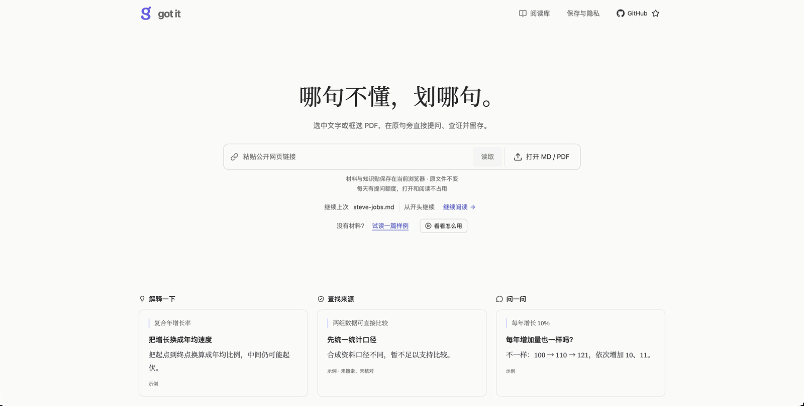
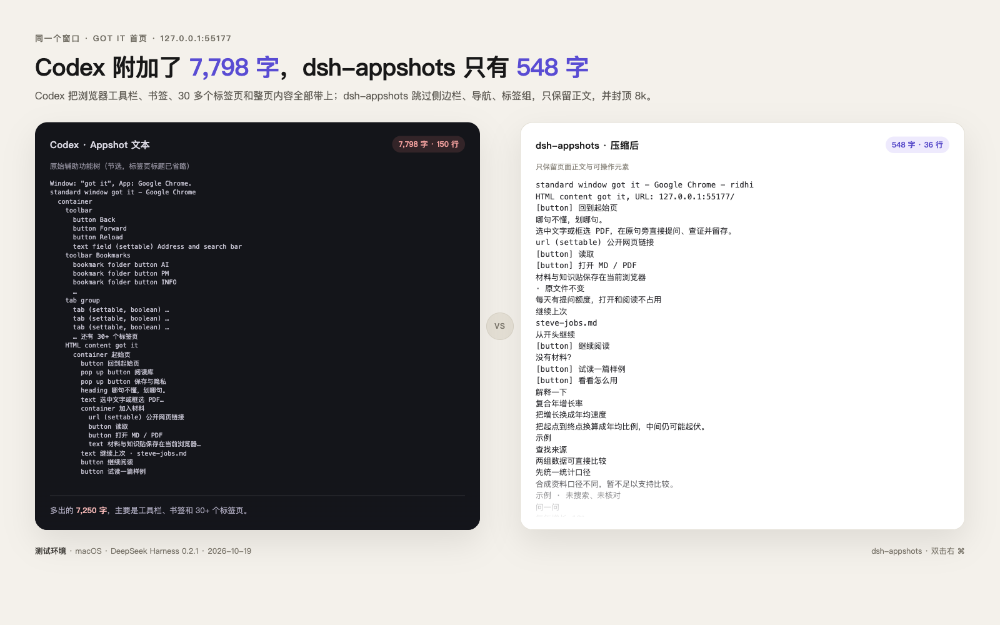

# dsh-appshots

[](https://awesome-dsh-plugin.com)

[简体中文](README.md) | English

Codex-style window capture for the official **DeepSeek Harness** desktop app, also compatible with [DSH Desktop](https://github.com/anywhere-labs/dsh-desktop), on macOS and Windows.

The default hotkey is **double-tap Right Command** (to avoid Codex's double-Command), or **Space + Right Command** or **Right Command + Right Option**, or the camera button next to the composer: grab the frontmost window and attach its screenshot to the composer draft. Nothing is sent until you send it; open the image to view the compact window text.

- Captures the frontmost window only, not the whole screen
- Attaches the screenshot to the composer draft; it is **never sent automatically**
- Plays the system camera shutter sound and immediately outlines the captured window (5px, ~1.8s), then brings DSH forward with the screenshot
- Opening the attached image shows a **View text** control with compact accessibility text (containers and Help removed, sidebars/navigation/tab groups skipped, buttons as `[button]`, capped at 8k characters; when over, the most recent content is kept)
- On send, only the image is sent; no hidden multi-thousand-character text is injected
- Does not skip DSH by default, so you can share the DSH window itself
- After capture, brings DeepSeek Harness (or DSH Desktop) to the front

## What it looks like

After double-tapping Right Command, the screenshot lands in the composer and **View text** shows the compact window text:



For the same Chrome window, Codex keeps the toolbar, bookmarks and 30+ tabs; dsh-appshots skips navigation and keeps only the page content:



## Install

```sh
dsh plugin --profile desktop add github:Bing-Bryan/dsh-appshots
```

Restart DeepSeek Harness after installing.

From source:

```sh
git clone https://github.com/Bing-Bryan/dsh-appshots.git
cd dsh-appshots
dsh plugin --profile desktop add .
```

On Windows the helper compiles on first capture with the system `csc.exe` (.NET Framework 4.x). Visual Studio is not required.

Release: bump `package.json` to `X.Y.Z` and push a `vX.Y.Z` tag. GitHub Actions opens the GitHub Release and publishes to npm with Trusted Publisher (OIDC).

## Permissions

### macOS

System Settings → Privacy & Security:

- **Screen Recording**: required to capture the frontmost window
- **Accessibility**: required to listen for the hotkey and read window text

Grant these to **DeepSeek Harness** (or **DSH Desktop** for the third-party shell). If the hotkey does not fire, also allow `appshot-capture`.

> `Space + Right Command` consumes the Space key to avoid Spotlight, but without Accessibility granted to the helper macOS may still open Spotlight. The default double-tap is the safer choice.

### Windows

- Screen capture uses `CopyFromScreen`; Windows may prompt once for screen access
- Window text uses UI Automation; some elevated or protected apps expose little or no text
- The default hotkey is both Ctrl keys. If it does not fire, try `hotkeyMode: win-hotkey`

## Use

1. Focus the window you want to share.
2. **Double-tap Right Command** (default on macOS, within 420ms) or both Ctrl keys (Windows), or click the camera button in the composer.
3. DeepSeek Harness comes to the front and the screenshot is attached to the composer draft; it is **not sent automatically**.
4. Open the image to use **View text**; add a prompt and send when ready.

If a session is currently open, the appshot goes there. If none is open, a new session is created. Consecutive captures go to the same session.

## Settings

Namespace `dsh-appshots` in `~/.dsh/settings.yaml`:

| Field | Default | Meaning |
|---|---|---|
| `skipSelf` | `false` | Skip DeepSeek Harness itself; `false` lets you capture the DSH window |
| `recentWindowMs` | `60000` | If no session is open, reuse the session captured within this window |
| `hotkeyMode` | `auto` | `auto` / `double-right-command` / `space-right-command` / `right-command-right-option` / `both-command` / `both-control` / `carbon` / `win-hotkey` / `off` |
| `carbonKeyCode` | `0` | Carbon key code when `hotkeyMode` is `carbon` |
| `carbonModifiers` | `256` | Carbon modifiers; 256 is Command |
| `winVk` | `44` | Virtual-key code when `hotkeyMode` is `win-hotkey` (44 is PrintScreen) |
| `winModifiers` | `3` | Win32 modifiers for `win-hotkey`; 3 is Ctrl+Alt |

`auto` is **double-tap Right Command** on macOS and both Ctrl keys on Windows. Pressing another key while Right Command is held (for example ⌘C) marks that press as not a clean tap, so shortcuts do not trigger a capture. To switch to Space + Right Command or Right Command + Right Option:

```yaml
dsh-appshots:
  hotkeyMode: space-right-command   # or right-command-right-option
```

## Limits

- macOS and Windows only
- Window text comes from the platform accessibility tree, so some apps expose only visible copy
- Window text is compacted: containers and Help removed, sidebars/navigation/tab groups skipped, buttons as `[button]`, long text merged, capped at 8k characters; older content is dropped first
- The compact text is view-only; it is not sent with the message, and the model only sees the screenshot
- Terminal pixels (VS Code xterm) are usually absent from accessibility, so compile logs still come from the screenshot
- Windows capture copies the on-screen pixels of the window rectangle; occluded windows include whatever is visible

## License

MIT
