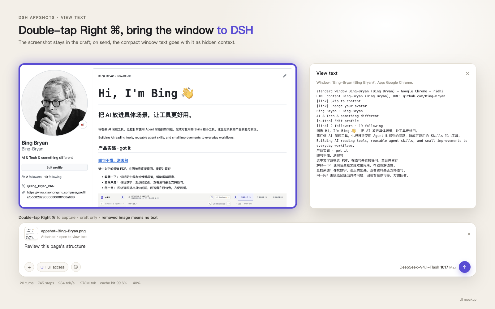

# dsh-appshots

[](https://github.com/Bing-Bryan/dsh-appshots/releases)
[](https://github.com/Bing-Bryan/dsh-appshots/blob/main/LICENSE)

[简体中文](README.md) | **English**

A window-capture plugin for the official **DeepSeek Harness** (also compatible with [DSH Desktop](https://github.com/anywhere-labs/dsh-desktop)). Double-tap Right Command, drop the frontmost window into the composer, and send its compact text as hidden context alongside the image.



*UI mockup: the target window is outlined, the screenshot lands in the composer, and View text shows the compact copy.*

## What it does

- **Double-tap Right Command / camera button**: capture the frontmost window only, not the whole screen
- **Capture feedback**: system shutter sound + a 5px glowing outline around the target window
- **Draft only**: the screenshot is never sent automatically; on send, the compact window text goes with it as hidden context
- **View text**: open the attached image to read the window text; if the image is removed or replaced, the text is not injected
- **Official Harness first**: does not skip DSH by default, and still works with DSH Desktop

## Install

Run in a terminal where `dsh` is available:

```sh
dsh plugin --profile desktop add "github:Bing-Bryan/dsh-appshots#v0.4.8"
```

> On macOS, if `dsh` is not on your PATH, use the bundled CLI:
> `"/Applications/DeepSeek Harness.app/Contents/Resources/runtime/cli/bin/dsh" plugin --profile desktop add "github:Bing-Bryan/dsh-appshots#v0.4.8"`

1. Restart DeepSeek Harness
2. Grant **Screen Recording** and **Accessibility** (see Permissions below)
3. Verify: double-tap Right Command. You should hear the shutter, see the target window outlined, then DSH comes forward with the image already in the composer
4. Open the image; **View text** should be in the top-right corner

To upgrade, replace `v0.4.8` with the new tag and restart:

```sh
dsh plugin --profile desktop add "github:Bing-Bryan/dsh-appshots#vX.Y.Z"
```

From source:

```sh
git clone https://github.com/Bing-Bryan/dsh-appshots.git
cd dsh-appshots
dsh plugin --profile desktop add .
```

On Windows the helper compiles on first capture with the system `csc.exe` (.NET Framework 4.x); Visual Studio is not required. The Windows path is inherited from upstream and has not been separately verified in this fork.

## Usage

1. Focus the window you want to share
2. macOS: double-tap Right Command (default, within 420ms); Windows: press both Ctrl keys; or click the camera button next to the composer
3. DSH comes forward with the screenshot attached to the composer, **not sent**
4. Open the image to read **View text**; add a prompt and send. The compact text follows the image as hidden context; if the image is removed before sending, the text is not injected

If a session is open, the Appshot attaches there; otherwise a new session is created. Consecutive captures go into the same session.

## View text and hidden context

The window text is compacted: containers and Help removed, sidebars/navigation/tab groups/toolbars skipped, buttons rendered as `[button]`, capped at 8k characters; when over the cap, the newest content is kept.

The compact text and the image share one unique filename binding:

- Image still present on send -> the text is injected once as hidden context
- Image removed, replaced, or never sent -> **no injection**

So a deleted image cannot leak its text into the conversation.

## Compared with Codex

Same Gemini answer: Codex returns 2,393 chars / 50 lines; dsh-appshots returns 2,006 chars / 13 lines. Similar length, but Codex keeps `split group`, `row/cell` and duplicate `Description` entries; dsh-appshots keeps only readable text, with buttons as `[button]`.


*A text-structure comparison, not a UI screenshot.*

## Why this fork

Upstream [`WongYuYe/dsh-appshots`](https://github.com/WongYuYe/dsh-appshots) targets DSH Desktop. This fork keeps upstream's window capture, camera button and Windows support, but rebuilds the capture path, text context and View text around the official **DeepSeek Harness**.

The changes are mainly in the native helper, host routes and client, not just the UI.

| | Upstream | This fork |
|---|---|---|
| Target app | DSH Desktop | Official DeepSeek Harness + DSH Desktop (`com.deepseek.dsh`, plus a parent-PID walk) |
| Hotkey | Both Command / Ctrl keys | Double-tap Right Command by default; Space + Right Command, Right Command + Right Option, and both Command also supported |
| Capture feedback | None | System shutter sound + a 5px glowing outline around the captured window |
| View text | Raw accessibility tree | Compact: sidebars/navigation/tab groups/toolbars skipped, duplicate `Description` removed, capped at 8k with the newest content kept |
| Text context | Bound on attach, injected on send | Compact text follows the image; **removed or replaced image means no injection** |
| Stability | AX/AppleScript forced activation | No AX frontmost write; LaunchServices activation, plus `sessions.open` compatibility |
| Capturing DSH itself | Skipped by default | Not skipped by default, so you can send the DSH UI itself |

In one line: **upstream is the generic DSH Desktop build; this fork is the official-Harness adaptation, focused on making screenshot, text and stability one reliable path.**

## Permissions

### macOS

System Settings -> Privacy & Security:

- **Screen Recording**: required to capture the frontmost window
- **Accessibility**: required for the hotkey and reading window text

Grant both to **DeepSeek Harness** (or **DSH Desktop** if you use the third-party shell). If the hotkey does not fire, also allow `appshot-capture`.

> The `Space + Right Command` path consumes the Space key to avoid Spotlight. If the helper does not have Accessibility permission, Spotlight may still appear. The default double-tap Right Command is the safer choice.

### Windows

- Capture uses `CopyFromScreen`; Windows may ask for screen access once
- Window text uses UI Automation; elevated or protected apps often expose little text
- The default hotkey is both Ctrl keys. If it does not fire, set `hotkeyMode: win-hotkey`

## Settings

Namespace `dsh-appshots`, stored in `~/.dsh/settings.yaml`:

| Field | Default | Meaning |
|---|---|---|
| `skipSelf` | `false` | Skip DeepSeek Harness itself; `false` by default, so you can capture DSH's own window |
| `attachText` | `true` | Inject the compact text as hidden context; set to `false` to keep View text only |
| `recentWindowMs` | `60000` | When no session is open, reuse a session captured within this window |
| `hotkeyMode` | `auto` | `auto` / `double-right-command` / `space-right-command` / `right-command-right-option` / `both-command` / `both-control` / `carbon` / `win-hotkey` / `off` |
| `carbonKeyCode` | `0` | Carbon key code when `hotkeyMode` is `carbon` |
| `carbonModifiers` | `256` | Carbon modifiers; 256 is Command |
| `winVk` | `44` | Virtual key code for `win-hotkey` (44 is PrintScreen) |
| `winModifiers` | `3` | Win32 modifiers for `win-hotkey`; 3 is Ctrl+Alt |

`auto` means **double-tap Right Command** on macOS and both Ctrl keys on Windows. If you press another key while holding Right Command (for example ⌘C), that press is not treated as a single tap. To use Space + Right Command or Right Command + Right Option:

```yaml
dsh-appshots:
  hotkeyMode: space-right-command   # or right-command-right-option
```

## Limits

- macOS and Windows only; the Windows path is inherited from upstream and has not been separately verified in this fork
- Window text comes from the platform accessibility tree, so some apps expose only visible copy
- Text is compacted: containers and Help removed, sidebars/navigation/tab groups skipped, buttons as `[button]`, long text merged, capped at 8k characters; older content is dropped first
- The compact text is sent as hidden context with the attached image; if the image is removed before sending, it is not injected
- Terminal pixels (VS Code xterm) are usually absent from accessibility, so compile logs still come from the screenshot
- Windows capture copies the on-screen pixels of the window rectangle; occluded windows include whatever is visible

## Release

A `vX.Y.Z` tag in this fork creates a GitHub Release with the tarball; `npm publish` runs only in the upstream repository, and the fork CI skips it.

## License

MIT
