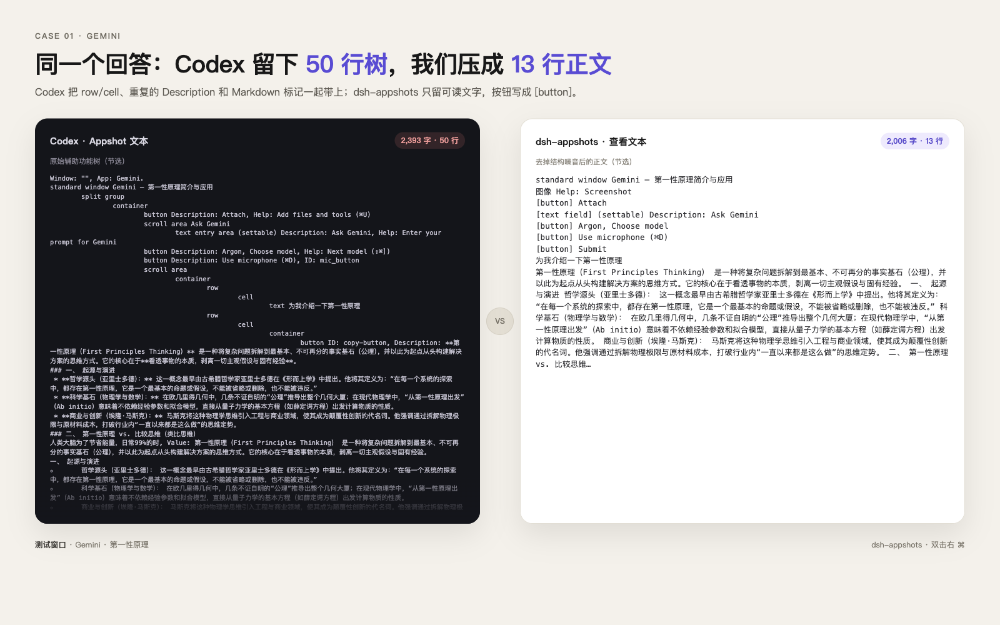

# dsh-appshots

[](https://awesome-dsh-plugin.com)

简体中文 | [English](README.en.md)

给官方 **DeepSeek Harness** 桌面端用的窗口截图，也兼容 [DSH Desktop](https://github.com/anywhere-labs/dsh-desktop)，支持 macOS 和 Windows。

默认热键是 **双击右 ⌘**（避开 Codex 的双 Command），也可以改成 **空格 + 右 ⌘** 或 **右 ⌘ + 右 ⌥**，或点输入框旁的相机，捕获当前前台窗口，把截图附加到输入框草稿；你不动它就不会发出。发送时，压缩后的窗口文字会作为隐藏上下文和图片一起带给模型；点开图片也能先查看这段文字。

- 只捕获最前面的窗口，不截整个屏幕
- 截图只附加到输入框草稿，**不会自动发送**；你不发送，它就一直在草稿里
- 捕获成功会播放系统快门声，并立即给目标窗口画一圈 5px 发光描边（约 1.8 秒），然后 DSH 到前台附上截图
- 点开已附加的图片，右上角有「查看文本」，展示压缩后的辅助功能文字（去容器/Help，跳过侧边栏/导航/标签组，按钮写成 `[button]`，最多 8k 字；超出时优先保留最近消息）
- 发送时会把压缩后的窗口文字作为隐藏上下文一起带给模型；**如果图片被移除，这段文字不会注入**
- 默认不跳过 DSH 自身：在 DSH 里按也会截 DSH，方便把界面本身发给模型
- 截图后自动把 DeepSeek Harness（或 DSH Desktop）调到前台

## 为什么有这个 fork

上游 [`WongYuYe/dsh-appshots`](https://github.com/WongYuYe/dsh-appshots) 是给 DSH Desktop 写的。这个 fork 保留上游的窗口捕获、相机按钮和 Windows 支持，但围绕官方 **DeepSeek Harness** 重做了捕获链路、文本上下文和查看文本。

不是只改了 UI：native helper、host 路由和客户端都改了。

| | 上游 | 这个 fork |
|---|---|---|
| 目标应用 | DSH Desktop | 官方 DeepSeek Harness + DSH Desktop（识别 `com.deepseek.dsh`，并沿父进程链找宿主） |
| 热键 | 同时按左右 Command / Ctrl | 默认双击右 ⌘；也支持空格 + 右 ⌘、右 ⌘ + 右 ⌥、同时按 |
| 捕获反馈 | 无 | 系统快门声 + 目标窗口 5px 发光描边 |
| 查看文本 | 原始辅助功能树 | 压缩：跳过侧边栏/导航/标签组/工具栏，去重 `Description`，8k 封顶并保留最近内容 |
| 文本上下文 | 附加时绑定，发送时注入 | 压缩文本随图片发送；图片被移除或替换就不注入 |
| 稳定性 | 通过 AX/AppleScript 强制前台 | 去掉 AX frontmost 写入，改用 LaunchServices 安全激活；修复 `sessions.open` 兼容 |
| 截 DSH 自身 | 默认跳过 | 默认不跳过，方便把 DSH 界面发给模型 |

一句话概括：**上游是 DSH Desktop 的通用版；这个 fork 是官方 Harness 的适配版，重点是把截图、文本和稳定性做成一条可靠的链路。**

## 和 Codex 对比

同一个 Gemini 回答：Codex 2,393 字 / 50 行，dsh-appshots 2,006 字 / 13 行。长度接近，但 Codex 保留了 `split group`、`row/cell` 和重复的 `Description`；dsh-appshots 只留可读正文，按钮写成 `[button]`。



## 安装

```sh
dsh plugin --profile desktop add github:Bing-Bryan/dsh-appshots
```

安装后重启 DeepSeek Harness。

从本地源码安装：

```sh
git clone https://github.com/Bing-Bryan/dsh-appshots.git
cd dsh-appshots
dsh plugin --profile desktop add .
```

Windows 会在第一次截图时用系统自带的 `csc.exe`（.NET Framework 4.x）编译助手，不需要安装 Visual Studio。

发布：把 `package.json` 版本改成 `X.Y.Z` 后推 `vX.Y.Z` tag。GitHub Actions 会打 GitHub Release 并用 Trusted Publisher（OIDC）发到 npm。

## 权限

### macOS

系统设置 → 隐私与安全性：

- **屏幕录制**：捕获最前面窗口所必需
- **辅助功能**：监听热键、读取窗口文字所必需

把这两项授予 **DeepSeek Harness**（用第三方壳时是 **DSH Desktop**）。如果热键不触发，同时允许 `appshot-capture`。

> `空格 + 右 ⌘` 这条路径会消费掉 Space 键，避免触发 Spotlight；但如果辅助功能权限没给到 helper，系统仍可能弹出 Spotlight。日常建议用默认的双击右 ⌘。

### Windows

- 截图走 `CopyFromScreen`，系统可能弹一次屏幕访问授权
- 窗口文字走 UI Automation，部分提权或受保护的应用几乎读不到文字
- 默认热键是同时按两边 Ctrl。如果不触发，可改成 `hotkeyMode: win-hotkey`

## 使用

1. 聚焦你想分享的窗口。
2. macOS **连续按两下右 ⌘**（默认，两下间隔 420ms 内），Windows 同时按两个 Ctrl，或点击输入框里的相机按钮。
3. DeepSeek Harness 来到前台，截图已附加到输入框，**不会自动发送**。
4. 点开图片可看「查看文本」；要发时自己补一句话，再点发送。发送时文字会作为隐藏上下文随图片一起带给模型；图片在发送前被移除就不会注入。

如果当前有打开的会话，Appshot 会附加到那里；如果没有，会新建一个会话。连续截图会进入同一个会话。

## 设置

命名空间 `dsh-appshots`，位于 `~/.dsh/settings.yaml`：

| 字段 | 默认值 | 含义 |
|---|---|---|
| `skipSelf` | `false` | 跳过 DeepSeek Harness 自身；默认 `false`，所以能截 DSH 自己的窗口 |
| `recentWindowMs` | `60000` | 没有打开会话时，复用这个时间窗口内截图过的会话 |
| `hotkeyMode` | `auto` | `auto` / `double-right-command` / `space-right-command` / `right-command-right-option` / `both-command` / `both-control` / `carbon` / `win-hotkey` / `off` |
| `carbonKeyCode` | `0` | `hotkeyMode` 为 `carbon` 时的 Carbon 键码 |
| `carbonModifiers` | `256` | Carbon 修饰键；256 是 Command |
| `winVk` | `44` | `hotkeyMode` 为 `win-hotkey` 时的虚拟键码（44 是 PrintScreen） |
| `winModifiers` | `3` | `win-hotkey` 的 Win32 修饰键；3 是 Ctrl+Alt |

`auto` 在 macOS 上是 **双击右 ⌘**，在 Windows 上是两边 Ctrl。按住右 ⌘ 期间如果按了别的键（比如 ⌘C），这一次不会被算作“单击”，避免误触。想换成空格加右 ⌘ 或右 ⌘ + 右 ⌥：

```yaml
dsh-appshots:
  hotkeyMode: space-right-command   # 或 right-command-right-option
```

## 限制

- 仅支持 macOS 和 Windows
- 窗口文字来自系统辅助功能树，部分应用只暴露可见文本
- 窗口文字会压缩：去容器/Help，跳过侧边栏/导航/标签组，按钮写成 `[button]`，长文本合并，最多 8k 字；超出时从前面省略、保留最近消息
- 压缩文本会随发送的图片作为隐藏上下文一起带给模型；如果图片在发送前被移除，文本不会注入
- 终端像素（如 VS Code xterm）默认不进辅助功能树，编译日志仍以截图为准
- Windows 截的是窗口矩形的屏幕像素，被挡住的窗口会带上挡住它的内容

## License

MIT
